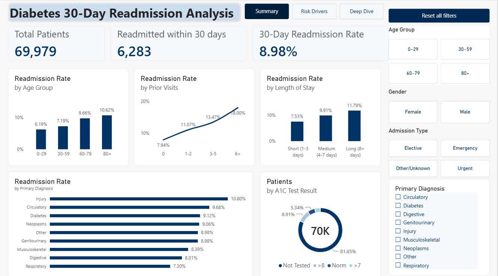
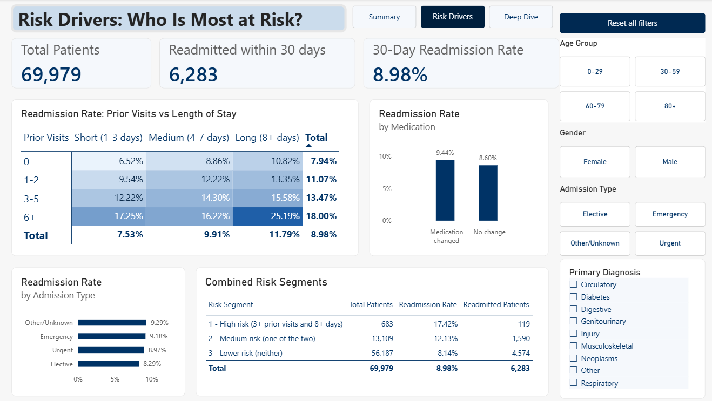
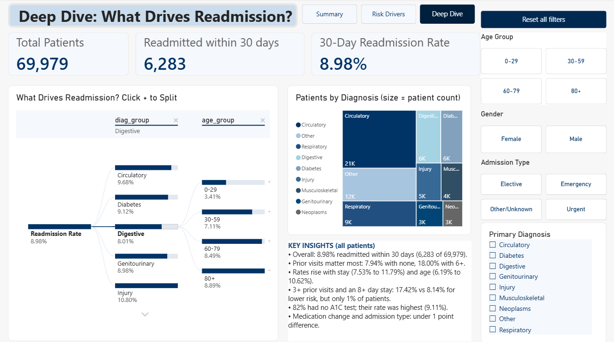

# 30-Day Readmission Analysis Among Diabetic Patients

An end-to-end healthcare data analytics project using **Python, MySQL and Power BI** to find which patient and hospital-stay factors are associated with 30-day hospital readmission.

> **Dataset:** Diabetes 130-US Hospitals for Years 1999-2008 (UCI Machine Learning Repository, licence CC BY 4.0). Source: https://archive.ics.uci.edu/dataset/296/diabetes-130-us-hospitals-for-years-1999-2008. The raw and cleaned data files are **not stored in this repository**; download the dataset from the link above. The Power BI file (.pbix) is submitted separately.

## Business Problem

Hospital readmissions within 30 days are costly and are often a sign that a patient's care could be improved. If a hospital knows which patient and stay factors are linked to higher readmission, it knows where to look first when planning discharge and follow-up care.

**Business questions**

1. What is the overall 30-day readmission rate?
2. Which factors (prior visits, length of stay, age, diagnosis, medication change, A1C testing, admission type) are linked to higher readmission?
3. Can these factors be combined into a simple risk grouping to show which patients need extra attention?

## Project Goal

1. Clean and prepare diabetic patient encounter data.
2. Measure the overall 30-day readmission rate.
3. Identify which factors (prior visits, length of stay, age, medication change, diagnosis, admission type) are associated with higher readmission.
4. Combine these factors into a simple risk segmentation (High, Medium, Lower risk).
5. Present the findings in an interactive three-page Power BI dashboard.

**Note:** The results show associations, not causes.

## Tools Used

| Tool | Purpose |
|------|---------|
| Python 3.12 (PyCharm, Jupyter Notebook) | Data profiling, cleaning, validation, feature engineering, EDA charts, loading data into MySQL |
| MySQL | Storing the cleaned table (schema in `00_schema.sql`) and running 9 SQL analysis queries |
| Power BI Desktop | Interactive 3-page dashboard (DAX measures, slicers, page navigation) |
| Git / GitHub | Version control and project sharing (code, charts and screenshots only) |

## Folder Structure

```text
diabetes_project/
├── notebooks/
│   └── diabetes_readmission_analysis.ipynb   # Commented notebook: profile, clean, validate, features, EDA, risk groups, MySQL load
├── python/
│   ├── 01_profile.py        # Profile the raw data
│   ├── 02_clean.py          # Clean data (101,766 rows -> 69,979 rows)
│   ├── 03_features.py       # Feature engineering (55 columns)
│   ├── 04_eda.py            # 7 EDA charts
│   └── 05_load_mysql.py     # Load cleaned data into MySQL
├── sql/
│   ├── 00_schema.sql        # Creates database and table (schema)
│   └── 06_sql_analysis.sql  # Data checks + 9 analysis queries
├── charts/                  # EDA charts produced by 04_eda.py
├── powerbi/
│   └── screenshots/         # Dashboard screenshots (3 pages)
├── data/                    # NOT included (download from the source link above)
├── README.md
└── .gitignore
```

> The `data/` folder and the Power BI file (`.pbix`) are not part of this repository. The `.pbix` file is submitted separately.

## How to Reproduce

> The dataset is **not included** in this repository. Download it from the UCI link at the top of this page and follow its licence (CC BY 4.0).

**1. Set up Python (3.12)**

```bash
pip install pandas matplotlib sqlalchemy pymysql notebook
```

**2. Download and add the data**

Download the dataset from the UCI link above. In the project root create the folders `data/raw/` and place the file `diabetic_data.csv` inside `data/raw/`.

**3. Run the analysis (choose one)**

- **Notebook (recommended):** start Jupyter in the project folder with `jupyter notebook`, open `notebooks/diabetes_readmission_analysis.ipynb` and run the cells from the top. Parts A to F need no database. Part G loads MySQL.
- **Scripts:** run these from the project root.

```bash
python python/01_profile.py
python python/02_clean.py
python python/03_features.py
python python/04_eda.py
```

**4. Prepare MySQL**

Run `sql/00_schema.sql` in MySQL Workbench. It creates the database `diabetes_db` and the table `diabetes_encounters`. Create a project user named `diabetes_user` with access to the database (optional lines are included in the schema file).

**5. Load the cleaned data into MySQL**

```bash
python python/05_load_mysql.py
```

The script asks for the MySQL password when it runs. The password is never stored in the code. This fills the table `diabetes_encounters` (69,979 rows).

**6. Run the SQL analysis**

Open `sql/06_sql_analysis.sql` in MySQL Workbench and run it. It starts with 3 data checks and then runs the 9 analysis queries.

**7. Power BI**

Connect Power BI Desktop to the `diabetes_encounters` table in MySQL. The dashboard file (`.pbix`) is not included in this repository; the screenshots in `powerbi/screenshots/` show the final result.

## Data Cleaning Summary

The raw data has 101,766 encounters and 50 columns. Each cleaning rule has a reason, and the row counts come from the cleaning script log.

| Cleaning rule | Rows removed | Why |
|---------------|--------------|-----|
| Drop `weight` column | - | 96.9% missing |
| Drop columns with one value in every row (`examide`, `citoglipton`) | - | No information |
| Remove invalid gender | 3 | Cannot be used in gender analysis |
| Remove patients who died or went to hospice | 2,423 | They cannot be readmitted, so they would distort the rate |
| Remove rows with no primary diagnosis | 20 | Patients are grouped by diagnosis |
| Keep only the first encounter per patient | 29,341 | Each patient counts once, so frequent patients do not dominate |
| Fill other missing values with "Unknown" | - | Avoids guessing values |
| **Result** | **31,787 removed in total** | **69,979 patients, 0 missing values** |

**Validation:** the notebook checks that every patient appears once, that no missing values remain, that no invalid gender or died/hospice patients remain, and that the target column only has the values `<30`, `>30` and `NO`. The SQL file repeats the row count and unique patient checks in MySQL.

## Key Findings

Overall, **8.98%** of patients (6,283 of 69,979) ended in 30-day readmission.

| Factor | Lowest group | Highest group |
|--------|--------------|---------------|
| Prior visits | 7.94% (0 visits) | 18.00% (6+ visits) |
| Length of stay | 7.53% (1-3 days) | 11.79% (8+ days) |
| Age | 6.19% (0-29 years) | 10.62% (80+ years) |
| Primary diagnosis group | 7.30% (Respiratory) | 10.80% (Injury) |
| Admission type | 8.29% | 9.29% (weak driver) |

**Other observations**

- **Medication change:** 9.44% (change) vs 8.60% (no change).
- **A1C test:** 81.65% of patients had no A1C test, and this group also had the highest readmission rate (9.11%).

**Combined risk segmentation**

| Risk segment | Definition | Patients | Readmission rate |
|--------------|-----------|----------|------------------|
| High risk | 3+ prior visits and 8+ days stay | 683 | 17.42% |
| Medium risk | Only one of the two (3+ prior visits or 8+ days stay) | 13,109 | 12.13% |
| Lower risk | Neither | 56,187 | 8.14% |

The highest single combination was **6+ prior visits with an 8+ day stay: 25.19%**.

> These results show **associations, not causes**.

## Business Recommendations

These suggestions come from the patterns above. They are ideas to test, not proven actions.

1. **Target follow-up at the High risk group.** Patients with 3+ prior visits and an 8+ day stay have a 17.42% readmission rate, about twice the overall 8.98%, and they are only 683 patients (about 1% of the data). A small, focused effort such as extra discharge planning or a follow-up call can reach them at low cost.
2. **Use prior visits as an early warning flag at admission.** The rate rises steadily from 7.94% (no prior visits) to 18.00% (6+ visits). Care teams can flag these patients on the first day.
3. **Review discharge planning after long stays.** Stays of 8+ days have an 11.79% rate, compared with 7.53% for 1-3 days.
4. **Give extra attention to older patients and injury-related admissions.** Patients aged 80+ (10.62%) and Injury diagnoses (10.80%) are above the overall rate.
5. **Record A1C results consistently.** 81.65% of patients have no A1C result, so the data cannot show whether testing matters. Better recording would allow a proper study.
6. **Do not rely on admission type or medication change alone.** Both show only small differences (admission type 8.29% to 9.29%, medication change 9.44% vs 8.60%).

**Next step for the analysis:** test these ideas with a predictive model validated on separate data and, if possible, a small pilot before changing care.

## Dashboard Screenshots

The Power BI dashboard has three pages with a page navigator, four synced slicers (age, gender, admission type, diagnosis) and a "Reset all filters" button. Only screenshots are included here; the `.pbix` file is submitted separately.

**1. Summary**



**2. Risk Drivers**



**3. Deep Dive**



## Limitations

- **Associations, not causes:** The analysis is descriptive. A higher readmission rate in a group does not mean that factor causes readmission.
- **No predictive model:** The High / Medium / Lower risk segments are simple rule-based groups built from prior visits and length of stay. They are not a validated prediction model and must not be used for clinical decisions.
- **Small high-risk group:** The High risk segment has only 683 patients (about 1% of the data), so its rate is based on a small group.
- **A1C data is mostly missing:** 81.65% of patients have no A1C test result, so conclusions about A1C are limited.
- **Weak drivers:** Medication change (9.44% vs 8.60%) and admission type (8.29% to 9.29%) show only small differences.
- **Data cleaning:** Cleaning reduced the data from 101,766 encounters to 69,979 patients. The main step was keeping only each patient's first encounter (29,341 repeat encounters removed), so the results describe first stays, not every stay.
- **Data not included:** The raw and cleaned data files are not stored in this repository, so the dataset must be downloaded from the source link to repeat the analysis.

## Data Source and Citation

Clore, J., Cios, K., DeShazo, J., & Strack, B. (2014). *Diabetes 130-US Hospitals for Years 1999-2008* [Dataset]. UCI Machine Learning Repository. https://doi.org/10.24432/C5230J
